# MoveEasy — Late-Delivery Risk Pipeline

**Name:** Maanoj Shara Chandran· **Email:** maanojgshara@hotmail.com

An end-to-end, configurable machine-learning pipeline that predicts — at the **point of pickup** —
the probability that a delivery will **miss its promised time** (`is_late`), then combines that
**calibrated risk** with a deterministic **impact weight** to produce a **risk × impact** score that
ranks each morning's dispatch queue. It lets MoveEasy's dispatch team prioritise attention on the
deliveries most likely to be late **and** most costly if they are — **without hiring more drivers**.

The repository is a faithful, modular port of the exploratory work in `eda.ipynb`: every
preprocessing and modelling decision is traceable to an EDA finding and is **model-type-aware**
(linear vs tree), leakage-safe, calibrated, and reproducible (locally and in GitHub Actions).

---

## Table of contents
1. [Project overview](#1-project-overview)
2. [Repository structure](#2-repository-structure)
3. [Setup & execution](#3-setup--execution)
4. [Pipeline flow](#4-pipeline-flow)
5. [EDA summary & preprocessing rationale](#5-eda-summary--preprocessing-rationale)
6. [Feature processing](#6-feature-processing)
7. [Model choice](#7-model-choice)
8. [Modelling process: metrics & hyperparameters](#8-modelling-process-metrics--hyperparameters)
9. [Evaluation & model performance](#9-evaluation--model-performance)
10. [Feature importance](#10-feature-importance)
11. [SHAP analysis](#11-shap-analysis)
12. [Error analysis](#12-error-analysis)
13. [Uncertainty quantification (calibration)](#13-uncertainty-quantification-calibration)
14. [Model comparison & selection](#14-model-comparison--selection)
15. [Risk × Impact: the business deliverable](#15-risk--impact-the-business-deliverable)
16. [Deployment considerations](#16-deployment-considerations)
17. [Limitations](#17-limitations)

---

## 1. Project overview

**Objective.** Build a supervised **binary classifier** that, at pickup, predicts `P(late)` for each
delivery; calibrate it; choose a cost-aware operating threshold; explain it; and layer a deterministic
**impact weight** so dispatch can rank the day's queue by **risk × impact**.

**Methods & workflow.** SQLite ingestion → cleaning → leakage-safe feature engineering → stratified
split + CV → multicollinearity handling → train **3 calibrated models** (Logistic Regression, Random
Forest, HistGradientBoosting) with class weights → randomized hyperparameter tuning → probability
calibration + cost-aware (and per-tier) thresholds → evaluation → interpretability (permutation
importance, SHAP) → error & bias-slice analysis → model selection → **risk × impact** ranking.

**Dataset.** Two SQLite tables (`delivery.db`):
- **`deliveries`** — 150,750 rows (→ **150,000** after de-duplication), 18 columns: depot `branch`,
  `client_id`, booking/pickup/promised/delivery datetimes, `distance_km`, `parcel_weight_kg`,
  `parcel_value_sgd`, `parcel_category`, `delivery_priority`, `num_stops_on_route`, `driver_id`,
  `driver_experience_months`, `vehicle_type`, `payment_method`, `recipient_postal_code`.
- **`feedback`** — 54,972 rows: `rating`, free-text `comment`, `feedback_datetime` (used in EDA to
  validate that lateness tracks dissatisfaction; **excluded** from the model to prevent leakage).
- **Label:** `is_late = delivery_datetime > promised_delivery_datetime` (~**10.97% positive**, 8.1 : 1
  imbalance). Only **pickup-time** fields are used as features; `delivery_datetime` and feedback are
  label/EDA only.

**Key findings (headline).** Lateness is a **modest but real, imbalanced** signal driven by route
load, driver experience, distance and parcel handling/priority. The selected model (**HistGBM**)
reaches **test PR-AUC ≈ 0.254** (~2.3× the 0.11 base rate), **ROC-AUC ≈ 0.73**, with well-calibrated
probabilities (Brier ≈ 0.09). Client importance is **orthogonal** to lateness risk — which is exactly
why it belongs in the *impact* weight, not the *risk* model.

---

## 2. Repository structure

```
repo/
├── data/                       # delivery.db (git-ignored; auto-downloaded if missing)
├── models/                     # serialised models (per-model subfolders + final_model.joblib)
├── artifacts/                  # pipeline outputs
│   ├── figures/                # plots (+ per-model SHAP subfolders)
│   ├── tables/                 # CSV results (+ per-model subfolders)
│   ├── runs/                   # JSON run/lineage records
│   └── logs/                   # main.log (training) + predict.log (inference)
├── src/                        # pipeline package
│   ├── config.py               # YAML config loader (+ CLI overrides)
│   ├── utils.py                # logger, progress bars, Artifacts saver, bar labels
│   ├── data_load.py            # SQLite download + ingestion
│   ├── feature_engineer.py     # feature engineering, feature groups, impact weight
│   ├── preprocess.py           # cleaning, multicollinearity, model-type preprocessors
│   ├── train.py                # models, CV baseline, tuning, calibration, thresholds
│   ├── evaluate.py             # metrics, ROC/PR, importance, SHAP, error & bias, comparison
│   ├── score.py                # risk × impact ranking
│   ├── main.py                 # TRAINING orchestrator (CLI entry point)
│   └── predict.py              # INFERENCE / serving entry point
├── config.yaml                 # single source of truth for all parameters
├── requirements.txt            # pinned dependencies
├── run.sh                      # training runner (used by GitHub Actions)
├── predict.sh                  # inference runner
├── trigger_run.sh              # local: install deps + run training (tee to output.txt)
├── trigger_predict.sh          # local: run inference (tee to output_predict.txt)
├── eda.ipynb                   # full exploratory data analysis (Sections 1–15)
├── .github/workflows/          # CI: install deps -> bash run.sh -> upload artifacts
└── README.md
```

---

## 3. Setup & execution

### Clone & install
```bash
git clone <your-repo-url>
cd <repo>
pip install -r requirements.txt          # versions pinned for Python 3.13 / scikit-learn 1.7
```
`data/delivery.db` is **auto-downloaded** from the assessment blob URL on first run if absent.

### Run on GitHub / a server (no local extras)
```bash
bash run.sh                # train: ingest -> ... -> risk × impact; writes artifacts/ + models/
bash predict.sh            # score data/delivery.db with the trained model -> predictions.csv
```
`run.sh` is exactly what the **GitHub Actions** workflow invokes.

### Run locally (Git Bash / WSL) — recommended
`trigger_run.sh` / `trigger_predict.sh` install deps, auto-detect your Python (`py`/`python`/`python3`),
stream output, and tee a full console log:
```bash
bash trigger_run.sh                       # training  -> output.txt
bash trigger_predict.sh                   # inference  -> output_predict.txt
```

### Modifying parameters — everything is in `config.yaml`
No code edits needed. Examples:
```yaml
test_size: 0.20            # hold-out fraction
cv_folds: 5                # StratifiedKFold
search_n_iter: 20          # randomized-search candidates per model
calib_method: isotonic     # probability calibration
fn_fp_cost_ratio: 5.0      # FN (missed late) costs 5× a false alarm  -> threshold
run_shap: true             # toggle the SHAP stage
per_segment_threshold: true# per-tier thresholds (lift VIP/premium recall, capped at global)
impact_weights: [0.4, 0.4, 0.2]   # (client freq, priority, parcel value) blend
models:                    # add/remove models or edit each model's hyperparameter grid
  hist_gbm:
    param_grid: { clf__learning_rate: [0.03,0.05,0.1,0.2], clf__max_iter: [200,400], ... }
```
A few run-level knobs can also be passed on the CLI (forwarded by the runners), e.g.
`bash run.sh --search-n-iter 40 --models logreg,hist_gbm`.

---

## 4. Pipeline flow

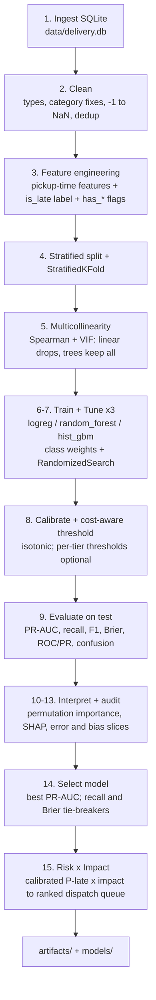

**Logical steps:** ingest → clean → engineer (label-safe, pickup-time only) → split (train-only fitting
thereafter) → multicollinearity diagnosis → train 3 class-weighted models with model-type preprocessing
→ randomized tuning on PR-AUC → calibrate + choose cost-aware (and per-tier) thresholds → evaluate on
the untouched test set → interpret (importance, SHAP) and audit (error/bias slices) → select the best
model → score risk × impact → persist everything. Training is orchestrated by `src/main.py`; inference
on new pickup-time data by `src/predict.py`.

---

## 5. EDA summary & preprocessing rationale

> Full analysis is in **`eda.ipynb`** (Sections 1–15). This is a condensed summary; rationale for each
> transformation is below.

**Methodology.** Two tables profiled and joined on `delivery_id`; data-quality, univariate, bivariate
(feature↔target and feature↔feature), missingness, and outlier analyses; then feature engineering and
post-feature checks — all under a strict **pickup-time feature contract** (no `delivery_datetime` /
feedback leakage).

**Key observations & the decisions they drove:**

| Observation (EDA) | Decision in the pipeline |
|---|---|
| **Target imbalanced** — 10.97% late, 8.1:1 | Stratified split + StratifiedKFold; **PR-AUC** primary metric; **class weights**; probability **calibration**; recall-leaning cost-aware threshold |
| **Inconsistent categories** (`Cnetral`/`cnetral`, `refrig.`, `over-sized`, casing) | `clean_data` lowercases/trims + maps typos → canonical labels |
| **Invalid `-1` sentinels** in weight/value/stops/experience | Replaced with `NaN` (not real measurements) |
| **Missingness ~4–5%, near-MAR**, mostly single-field, uncorrelated | **Median (numeric) / mode (categorical) imputation** fit in-pipeline on train; **`has_*` missing-indicator flags retained** (low-cost signal) — *no row/column dropping* |
| **Right-skew** (`parcel_value_sgd` skew ≈ 7.5, weight ≈ 3.7, distance ≈ 1.8) | **`log1p` + winsorise (0.5/99.5) + RobustScaler** — **linear model only**; trees are scale/outlier-invariant |
| **Strong numeric signal**: `num_stops_on_route` (AUC ≈ 0.63), driver experience (inverse), distance, promised window | Kept as core predictors; built interaction features |
| **Categorical signal**: `parcel_category` & `delivery_priority` (Cramér's V ≈ 0.11), `promised_service_tier`, `branch` | One-hot encoded (kept) |
| **Near-zero signal**: `vehicle_type`, `payment_method`, weekend (V ≈ 0) | **Dropped** from the model |
| **Redundant clusters**: `promised_window_mins`↔`delivery_priority_rank` (ρ≈−0.89), `distance_km`↔`stops_per_km` (ρ≈−0.75) | One member per cluster **dropped** (e.g. `promised_window_mins`, `booking_to_pickup_mins`, `stops_per_km` not used); a train-fit **VIF** check trims residual collinearity for the linear model |
| **`client_id_frequency` has no lateness signal** (AUC ≈ 0.50) | **Excluded from the risk model**; reserved for the **impact weight** (validates the risk × impact design) |
| **`recipient_postal_code`** = 37 levels | **Target/mean-encoded** (cross-fitted, leak-safe) with an Unseen bucket |

**Categorical handling (explicit):** ordinal tiers → monotone integer ranks (`delivery_priority_rank`,
`parcel_handling_sensitivity`); low-cardinality nominals → One-Hot (rare levels collapsed,
`handle_unknown` for deployment safety); high-cardinality postal → TargetEncoder; all preceded by **mode
imputation**, so encoders never see `NaN`.

---

## 6. Feature processing

29 candidate features, processed **model-type-aware** (trees need no scaling/winsor/bins; the linear
model does). Imputation/encoding/scaling are fit **inside the CV pipeline on training folds only**.

| Feature group | Examples | Tree model | Linear model |
|---|---|---|---|
| **Numeric (raw)** | `distance_km`, `parcel_weight_kg`, `parcel_value_sgd`, `num_stops_on_route`, `driver_experience_months`, `pickup_hour/month/day` | median impute | median impute → **winsorise 0.5/99.5** → **log1p** (skewed) → **RobustScaler** |
| **Ordinal ranks** | `delivery_priority_rank`, `parcel_handling_sensitivity` | as numeric | as numeric (scaled) |
| **Engineered interactions/ratios** | `stops_x_distance`, `exp_per_stop`, `value_per_kg`, `route_load_per_exp` | median impute | impute → scale (+ log/winsor where skewed) |
| **Quantile bins** | `distance_km`, `parcel_value_sgd`, `driver_experience_months` | not used | `KBinsDiscretizer` (threshold effects) |
| **Binary flags** | `is_high_risk_handling`, `is_standard_priority`, `pickup_is_peakhour` | passthrough | passthrough |
| **Missing-indicator flags** | `has_num_stops_on_route`, `has_vehicle_type`, … (7) | passthrough | passthrough |
| **Nominal (low-card)** | `branch`, `parcel_category`, `delivery_priority`, `promised_service_tier` | mode impute → One-Hot | mode impute → One-Hot |
| **High-cardinality** | `recipient_postal_code` (37) | mode impute → TargetEncoder | mode impute → TargetEncoder |
| **Multicollinearity (linear only)** | high-VIF / correlated members | kept | **dropped** (e.g. `exp_per_stop`, `driver_experience_months`) |
| **Reserved for impact, not risk** | `client_id_frequency` | — | — |

Saved: `artifacts/tables/feature_inventory.csv`, `vif.csv`, `spearman_corr.csv`.

---

## 7. Model choice

The data is **tabular, mixed-type, class-imbalanced, right-skewed, mildly collinear, with modest
non-linear signal spread across many features**, and there is a strong need for **interpretability**
(dispatch must trust the score). Three models were chosen accordingly:

- **Logistic Regression (L2)** — transparent, well-calibrated **interpretable baseline**; needs the
  log/scale/encoding above. Tests whether complexity is justified.
- **Random Forest** — non-linear, robust bagged trees; a cross-check.
- **HistGradientBoosting** — **primary**: captures non-linear/threshold/interaction effects, robust to
  skew/outliers/collinearity, handles missing values natively, supports class weights, calibrates well.

All three use **`class_weight="balanced"`** (the recommended-first imbalance action). Each is paired with
its **model-type preprocessor**. SVM/KNN (poor fit at 150k rows with heavy skew) and deep nets
(unnecessary for tabular data with modest signal and an interpretability requirement) were deliberately
not used.

---

## 8. Modelling process: metrics & hyperparameters

**Evaluation metrics (and why):**
- **PR-AUC (primary)** — under 8:1 imbalance, ROC-AUC is over-optimistic; PR-AUC focuses on the minority
  *late* class and is threshold-free (fair model-comparison metric).
- **Recall (late)** — prioritised because a **false negative (missed late delivery) is costlier** than a
  false alarm, especially for major clients/high tiers.
- **Precision, F1, balanced accuracy** — supporting views; **Brier score / reliability** — because the
  output is a *probability* consumed inside the impact product (calibration matters).
- Raw accuracy is avoided (an all-on-time classifier already scores ~89%).

**Hyperparameter search.** `RandomizedSearchCV`-style search (efficient, dependency-free) optimising
**PR-AUC** under StratifiedKFold; full trial histories saved (`artifacts/tables/<model>/trials_*.csv`).
Final configurations (from `tuning_summary.csv`):

| Model | Best CV PR-AUC | Final hyperparameters |
|---|---|---|
| logreg | 0.2550 | `C = 0.01` (strong L2) |
| random_forest | 0.2544 | `n_estimators=200, max_depth=30, min_samples_leaf=20, max_features=sqrt` |
| **hist_gbm** ✅ | **0.2586** | `learning_rate=0.05, max_iter=400, max_leaf_nodes=31, l2_regularization=1.0, min_samples_leaf=20` |

The chosen configs favour **regularisation** (small `C`; leaf/depth limits; `l2`), consistent with the
thin, noisy signal — they generalise rather than overfit.

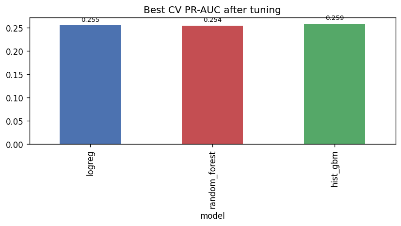

---

## 9. Evaluation & model performance

Final evaluation on the untouched **30,000-row test set**, using calibrated probabilities at each
model's cost-aware threshold (`artifacts/tables/test_metrics.csv` / `final_results.csv`):

| Model | PR-AUC | ROC-AUC | Recall | Precision | F1 | Balanced acc | Brier | Threshold |
|---|---|---|---|---|---|---|---|---|
| logreg | 0.2513 | 0.7305 | 0.488 | 0.244 | 0.326 | 0.651 | 0.090 | 0.15 |
| random_forest | 0.2520 | 0.7296 | 0.450 | 0.257 | 0.327 | 0.645 | 0.090 | 0.16 |
| **hist_gbm** ✅ | **0.2536** | **0.7344** | 0.460 | 0.251 | 0.325 | 0.645 | **0.0898** | 0.17 |

**Reading it:** PR-AUC ≈ 0.25 vs a **0.11 base rate** ≈ **2.3× lift**; ROC-AUC ≈ 0.73. The signal is
modest (an EDA-confirmed data ceiling), but real, well-calibrated, and the three models agree — a good
robustness sign. Recall ≈ 0.46–0.49 at the recall-leaning threshold.

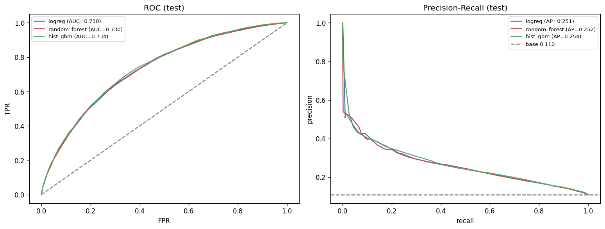
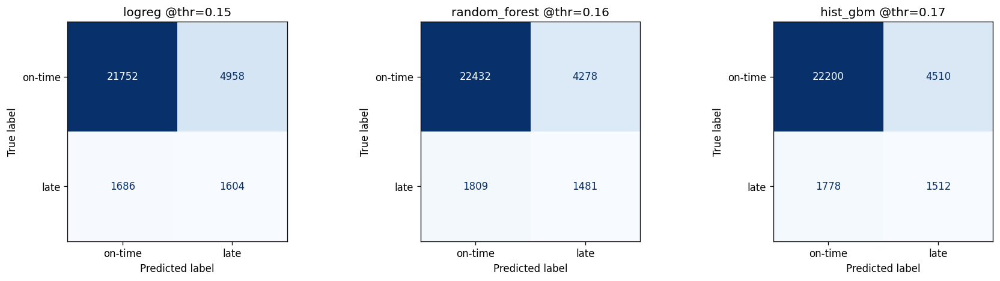

---

## 10. Feature importance

**Permutation importance** (model-agnostic, PR-AUC drop on a test sample) over the original input
features, per model + merged (`artifacts/tables/feature_importance_merged.csv`):

| Feature | mean ΔPR-AUC across models |
|---|---|
| `route_load_per_exp` | 0.039 |
| `delivery_priority_rank` | 0.020 |
| `stops_x_distance` | 0.016 |
| `branch` | 0.014 |
| `distance_km` | 0.013 |
| `num_stops_on_route` | 0.011 |
| `parcel_handling_sensitivity` | 0.010 |

The leaders — **route load relative to driver experience, priority, distance, parcel handling** — match
the EDA's separation ranking; the `has_*` flags sit near zero (consistent with near-MAR missingness).

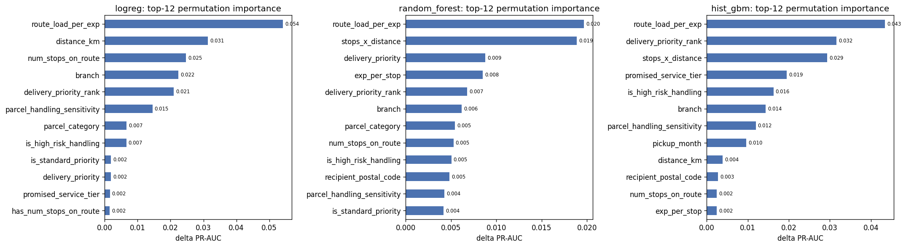

---

## 11. SHAP analysis

SHAP run for all three models (`TreeExplainer` for trees, `LinearExplainer` for logreg) on a sample, as
an optional training-time stage (`artifacts/figures/<model>/shap_<model>.png`,
`artifacts/tables/<model>/shap_top_<model>.csv`). SHAP corroborates permutation importance and the EDA —
route load, distance, priority and parcel handling dominate contributions — providing stakeholder-facing
explanations of *why* a delivery is flagged.

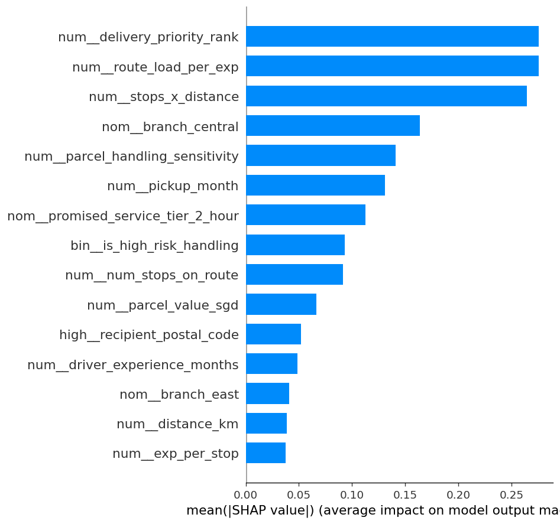

---

## 12. Error analysis

Misclassifications for the chosen model exported (`artifacts/tables/misclassified.csv`) and sliced by
operational segment. **Top failure modes** (`top_failure_modes.csv`) — highest false-negative rate with
adequate support:

| Segment | Level | n | FN-rate |
|---|---|---|---|
| delivery_priority | **vip** | 1,202 | 0.93 |
| promised_service_tier | 2_hour | 6,057 | 0.83 |
| delivery_priority | premium | 3,878 | 0.81 |
| branch | central | 9,038 | 0.75 |
| parcel_category | standard | 22,251 | 0.65 |

**Why:** VIP/premium/2-hour are **rarely late** (very few positives), so they're the hardest to catch —
an honest, signal-limited weakness (addressed below via per-tier thresholds), not a bug.

---

## 13. Uncertainty quantification (calibration)

Because the score feeds a probability × impact product, probabilities are **calibrated (isotonic)** on a
held-out slice and assessed with **reliability curves + Brier score**
(`artifacts/tables/calibration_thresholds.csv`):

| Model | Brier (uncalibrated) | Brier (calibrated) |
|---|---|---|
| logreg | 0.209 | **0.090** |
| random_forest | 0.157 | **0.090** |
| hist_gbm | 0.202 | **0.090** |

Calibration **materially improves** probability quality (lower Brier; reliability curves hug the
diagonal), so the risk axis of risk × impact is trustworthy.

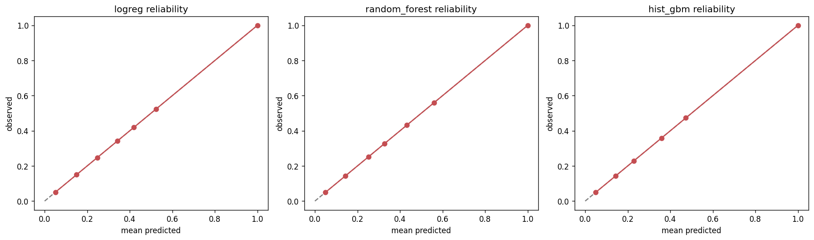

---

## 14. Model comparison & selection

All models compared on one table + figure (`model_comparison.csv`, `final_results.csv`). **Selection
rule:** **PR-AUC** primary, then **recall** (FN cost) and **Brier** (calibration) as tie-breakers →
**`hist_gbm`** selected (`artifacts/runs/model_selection.json`), saved as `models/final_model.joblib`.

**Threshold policy:** ranking-first (dispatch works down the risk × impact queue); where a binary
"at-risk" flag is needed, a **cost-aware threshold** (FN:FP = 5:1) is used (0.17 for hist_gbm).
**Optional per-tier thresholds** (`per_segment_threshold: true`) **cap each tier's threshold at the
global** so they can only *lift* recall, never regress it (`segment_threshold_comparison.csv`):

| Tier | Threshold | Recall (global → per-tier) |
|---|---|---|
| **vip** | 0.16 | 0.067 → **0.133** (+0.067) |
| premium / standard / express | 0.17 | unchanged (capped) |

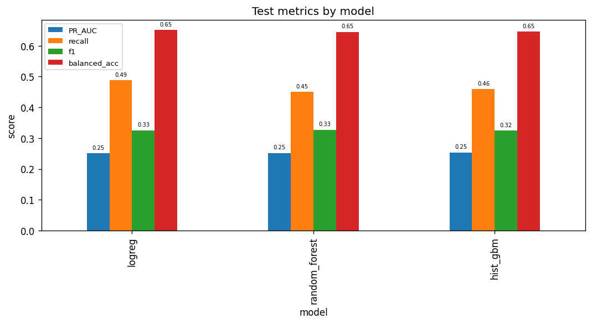
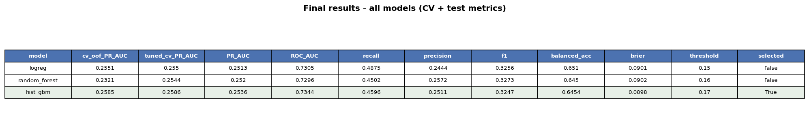
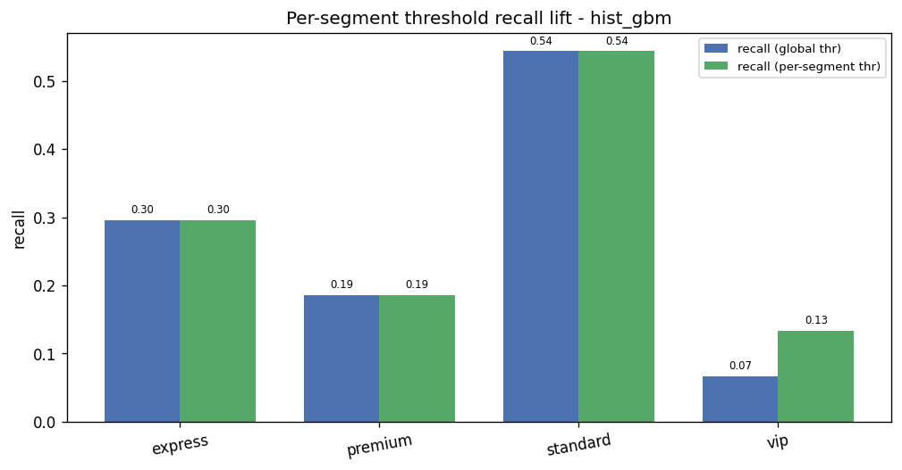
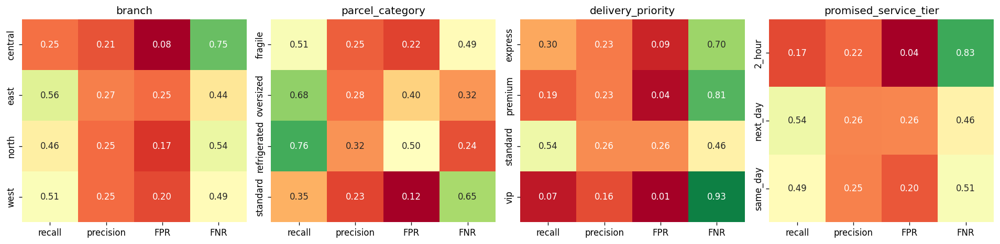

---

## 15. Risk × Impact: the business deliverable

`src/score.py` combines the calibrated **risk** `P(late)` with a deterministic **impact weight** —
a [0,1] blend (weights `0.4/0.4/0.2`) of **client importance** (`client_id_frequency`), **priority tier**
(`delivery_priority_rank`) and **(log) parcel value** — into a **`risk × impact`** score that ranks the
queue. Inference (`src/predict.py`) reproduces this on new data: it scored 150,000 deliveries, flagging
~20% at-risk, and writes the ranked **top-20 dispatch queue** (`predictions_top20.csv`).

`client_id_frequency` carries **no lateness signal** (EDA AUC ≈ 0.50), so it sits **only** on the impact
axis — keeping risk and impact independent, exactly as intended. The top of the queue surfaces
high-value oversized/refrigerated/premium/VIP deliveries that are both likely-late and costly.

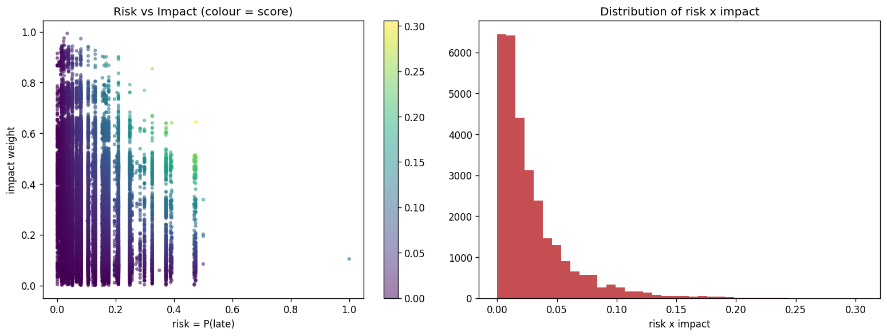

---

## 16. Deployment considerations
- **Serving:** load `models/final_model.joblib` (a calibrated `Pipeline`) and call `src/predict.py` on
  new pickup-time records (CSV or SQLite). Preprocessing is inside the pipeline, so raw inputs are
  accepted; it works **without `delivery_datetime`** (outcome unknown at pickup).
- **Refit-on-train / leakage:** `client_id_frequency` and target encoding are fit on training data — in
  production refit on a rolling window and **recalibrate periodically**.
- **Monitoring / drift:** track input distributions, the realised late rate, PR-AUC/recall and
  **calibration (Brier/reliability)** over time; retrain on drift. Watch the high-impact, low-prevalence
  tiers (VIP/premium) where recall is weakest.
- **Unseen categories:** OHE uses `handle_unknown="infrequent_if_exist"`; new postal areas fall back via
  the target encoder — safe by construction.
- **Threshold governance:** the threshold and `fn_fp_cost_ratio` encode a business cost trade-off; review
  with operations; per-tier thresholds are available for high-impact tiers.
- **Reproducibility / lineage:** seeded; every run logs config/params/metrics to `artifacts/runs/*.json`
  and `artifacts/logs/`; dependencies pinned; validated locally **and** in GitHub Actions.

---

## 17. Limitations
- **Modest predictive power** (PR-AUC ≈ 0.25): the pickup-time signal is genuinely thin (EDA), so the
  tool is best as a **prioritisation ranker**, not a precise late/not-late classifier.
- **Low recall on high-impact tiers** (VIP 0.07, premium 0.19): these are rarely late and hard to
  predict; per-tier thresholds lift VIP recall but at a precision cost — a deliberate trade-off.
- **Impact weight dominated by the largest client** (C0000 ≈ 20% of volume): faithful to the brief
  ("importance ∝ frequency") but tunable via `impact_weights` / per-client normalisation.
- **No driver/route history features** (e.g. a driver's prior late-rate) — likely the highest-upside
  future work, but must be engineered **leak-safe** (out-of-fold / time-aware).
- **CI runtime** ~70+ min on GitHub's 2-core runners (≈14 min locally); trim `search_n_iter` / set
  `run_shap: false` for faster CI